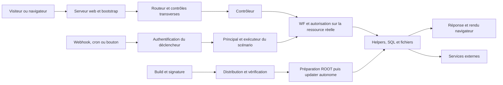

# Modèle de menace

## Objectifs et hypothèses

Préserver la confidentialité des comptes, secrets, configurations, données
non publiées et sauvegardes ; préserver l'intégrité des permissions, contenus,
scénarios, fichiers et releases ; maintenir la disponibilité et borner les coûts.

Décisions confirmées : médias/HLS lisibles par URL, administrateurs de Space
et auteurs de scénarios de confiance limitée, automatisation activée en production.
ROOT, opérateur d'hébergement et signataire des paquets sont des rôles de
confiance pour leurs opérations privilégiées ; leurs comptes/clefs peuvent être
compromis. Le code d'une extension PHP installée a les droits de l'application :
aucune isolation d'exécution par namespace n'est supposée.

Les données d'un compte rendu IA, d'un IdP, d'un webhook, d'une bibliothèque
distante et d'un fichier importé restent non fiables jusqu'à validation.
Un identifiant de Space, un rôle ou une permission transmis par Vue n'est
jamais une preuve d'autorisation.

## Actifs à protéger

| Actif | Propriété attendue | Particularité |
| --- | --- | --- |
| Comptes, mots de passe, sessions et liens SSO | Confidentialité, intégrité, révocation effective | Plusieurs sessions et deux stockages possibles. |
| ROOT, rôles/groupes et ACL d'objets | Délégation bornée et isolation des Spaces | Héritage descendant ; ROOT global fondé sur le Space 1. |
| Pages, brouillons et configurations | Lecture/écriture autorisées ; rendu sûr | Un auteur de contenu ne doit pas exécuter de script dans l'administration. |
| Scénarios, événements et résultats | Principal explicite, droits actuels et budgets | Publication et déclenchement sont deux opérations distinctes. |
| Secrets applicatifs, IA, SMTP, OAuth, webhook et cron | Non divulgation, usage limité et récupération | Le secret applicatif est aussi nécessaire pour relire certaines données chiffrées. |
| Médias/HLS | Intégrité de gestion, chemins et rendu sûrs | Confidentialité de lecture non demandée ; ne pas y déposer de secrets privés. |
| Logs, temporaires et backups | Confidentialité, intégrité, conservation bornée | Leur lecture peut donner accès à d'autres actifs si des secrets y sont copiés. |
| ZIP, signatures, configuration et release active | Authenticité, intégrité et activation cohérente | Une opération interrompue ne doit pas rendre la récupération impossible. |
| CPU, mémoire, disque, SQL et services payants | Disponibilité et coût bornés | Webhooks, regex, compilation, IA, SMTP et scénarios amplifient les appels. |

## Acteurs

| Acteur | Capacités de départ | Limite à préserver |
| --- | --- | --- |
| Visiteur anonyme | Requêtes web, inscription/récupération, lecture des ressources publiques | Aucun accès aux données privées ou à une action métier sans preuve prévue. |
| Membre connecté | Session valide et permissions limitées | Aucun accès à un autre compte, objet ou Space par changement d'ID. |
| Éditeur de contenu | HTML structuré, liens, fichiers et brouillons selon ses droits | Aucun script privilégié, fichier exécutable ni accès réseau arbitraire. |
| Administrateur de Space malveillant/compromis | Configuration, utilisateurs et délégations effectivement accordées | Aucun droit hors de son périmètre ni transfert indu de ROOT. |
| Auteur de scénario malveillant/compromis | Code du langage et publication selon ses permissions | Aucun contournement de WF, principal, capacités ou budgets. |
| Appelant webhook/cron/bouton | Charge utile et éventuellement un jeton valide/volé | Seules les opérations prévues par ce jeton ; pas d'accès global implicite. |
| Fournisseur externe ou contenu IA hostile | Réponse HTTP/SMTP/OIDC, URL et contenu non fiables | Aucune autorisation dérivée de sa seule réponse, ni extraction de secrets locaux. |
| ROOT/opérateur/signataire compromis | Pouvoirs étendus propres à son rôle | Limiter fuites, exposition et propagation ; identifier sauvegarde et récupération. |
| Dépendance ou extension compromise | Code exécuté au build ou au runtime | Maîtriser provenance, paquet livré et installation ; une signature n'est pas un bac à sable. |

## Frontières principales

Le schéma exprime les frontières à vérifier, pas une garantie que chaque
chemin appelle effectivement un WF. Les routes historiques, helpers directs,
fichiers statiques et entrées autonomes sont détaillés dans [les entrées](ENTREES.md).

## Scénarios d'abus à éprouver

| ID | Scénario | Preuve de refus attendue | Lots |
| --- | --- | --- | --- |
| M-01 | Modifier l'ID d'une ressource ou son Space pour lire/écrire ailleurs. | Le serveur relit la ressource et refuse avant lecture protégée/écriture ; listes et aperçus compris. | 04, 08 |
| M-02 | Déléguer une permission non détenue, transmettre ROOT indirectement ou réutiliser un cache ACL périmé. | Refus des délégations indues, héritages et droits d'instance ; retrait appliqué selon le contrat. | 04, 12 |
| M-03 | Voler/fixer une session, modifier l'e-mail, lier une identité ou récupérer le compte. | Vérifications adaptées à l'action, jetons à usage prévu, blocage et révocation éprouvés dans les deux stockages. | 05, 06, 07 |
| M-04 | Déclencher une mutation depuis un autre site, un GET chargé automatiquement ou un callback rejoué. | Preuve d'intention/provenance vérifiée au serveur ; portée des exceptions démontrée. | 03, 06, 07 |
| M-05 | Introduire du HTML/SVG/CSS/Markdown ou une réponse IA qui s'exécute chez un administrateur. | Rendu inoffensif selon le contexte ; sandbox/postMessage/CSP et anciens formats inclus. | 09, 11 |
| M-06 | Téléverser un fichier actif, traverser un chemin ou exploiter un lien pour lire/écraser hors du dossier prévu. | Refus indépendant du navigateur, vérification du chemin réel et absence d'exécution par le serveur web. | 10, 14, 15 |
| M-07 | Faire contacter une IP interne ou exfiltrer des données via URL, DNS, redirection, fournisseur IA ou notification. | Requêtes réseau bornées et destinations autorisées ; secrets et droits séparés du contenu reçu. | 07, 11, 12 |
| M-08 | Publier un scénario puis provoquer une exécution sous un principal plus puissant, ou après retrait de droits. | Identité et Space explicites à chaque action, permission actuelle, aucun recours silencieux à ROOT/service privilégié. | 04, 12 |
| M-09 | Rejouer un webhook/bouton, appeler le cron sans secret ou exploiter son mode résultat. | Authentification, portée, déduplication et sorties maîtrisées ; transactions et effets externes examinés. | 03, 12, 13 |
| M-10 | Saturer regex, parseur, compilation, runs, stockage, e-mails ou appels IA. | Bornes aux couches utiles, quotas concurrents et refus précoce ; pas de test de charge en production. | 03, 08, 11, 12, 16 |
| M-11 | Récupérer un secret via erreur, log, cache, JSON de modèle ou backup public. | Absence de donnée sensible dans les sorties ; ACL et droits disque privés vérifiés. | 02, 13, 15, 16 |
| M-12 | Livrer un paquet altéré, substituer une clé/manifeste, extraire un ZIP sortant ou rejouer une version. | Authentification complète de la chaîne et validation de l'archive avant tout code ou copie sensible. | 02, 14, 15 |
| M-13 | Utiliser/rejouer un lien updater, sauter une étape ou interrompre une migration/restauration. | Secret révocable, CSRF autonome, états et verrous cohérents, récupération sur fixture isolée. | 13, 15 |
| M-14 | Exploiter un hôte/proxy non fiable, un mode DEV ou un outil de diagnostic exposé. | Contrat de confiance explicite et protections de déploiement ; aucune autorité accordée à un en-tête arbitraire. | 03, 16 |

Le lot 17 combinera ces scénarios : contenu hostile vers session ROOT,
erreur/log vers lien updater, droit retiré vers exécution auteur/service,
et paquet authentifié vers code d'extension. La couverture sera réexaminée
si le code ou la configuration change pendant l'audit.
